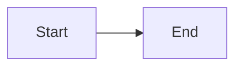
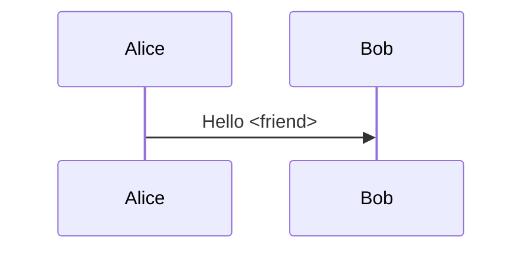

# Report

| Item | Status |
| --- | --- |
| Table | Ready |

```rust
let value = "<safe>";
```

```js
const value = "<script>alert('code')</script>";
```

```sh
echo "<safe>" && printf '%s\n' "$HOME"
```

```unknown-language
<script>alert('unknown')</script> & plain
```

```
<script>alert('plain')</script> & plain
```

- [x] Done
- [ ] Pending





```mermaid
not a valid diagram
```

<script>alert('unsafe')</script>

## End

Rest of page intact.
