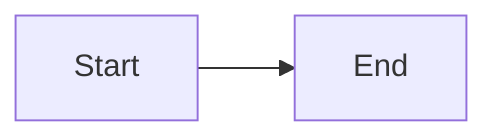
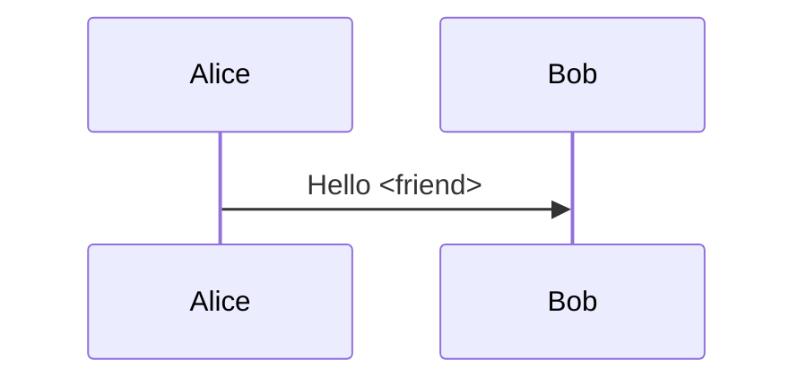

# Report

| Item | Status |
| --- | --- |
| Table | Ready |

```rust
let value = "<safe>";
```

- [x] Done
- [ ] Pending





```mermaid
not a valid diagram
```

<script>alert('unsafe')</script>

## End

Rest of page intact.
